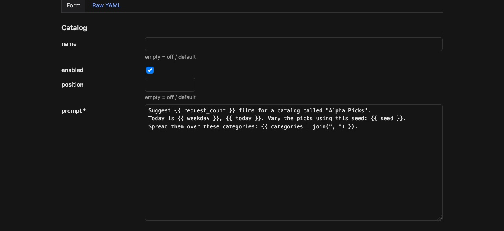
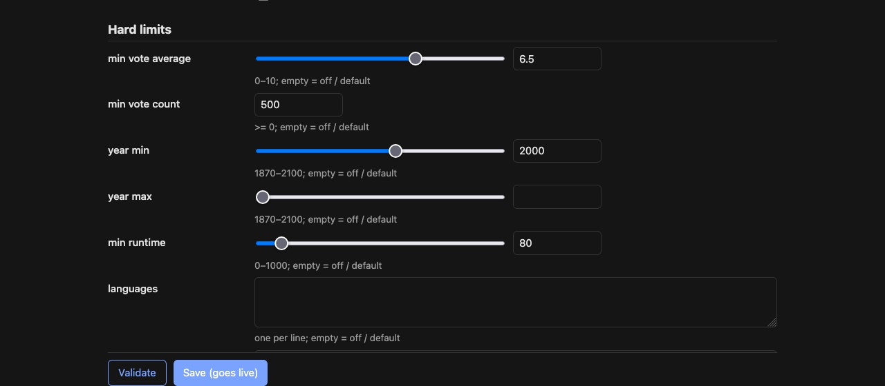
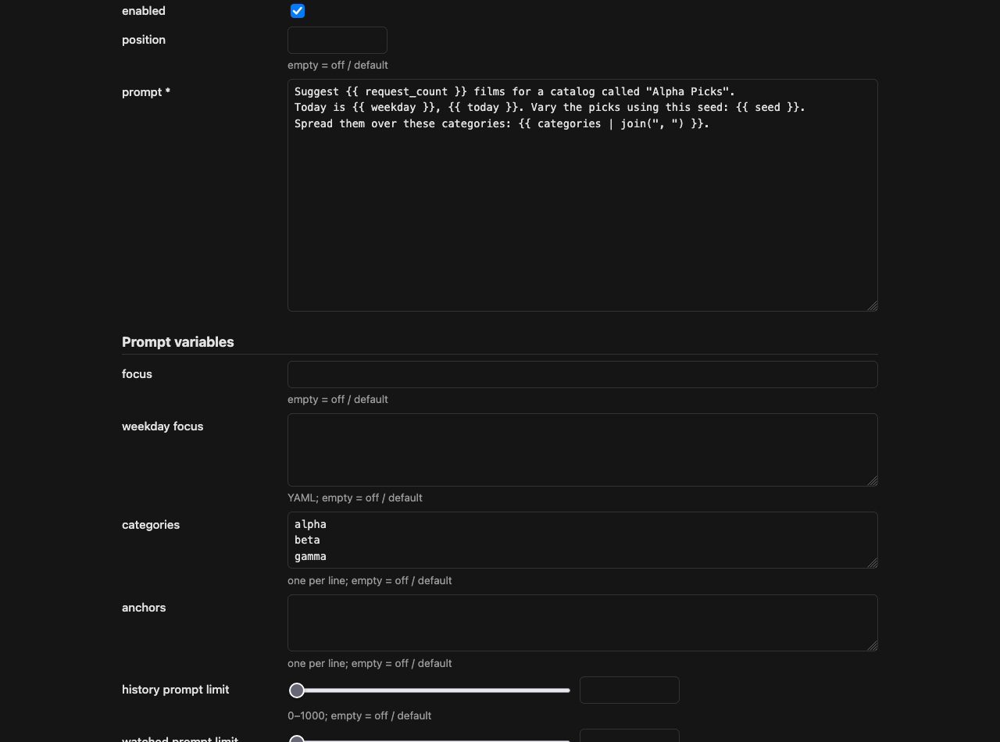

  

<h1 align="center">AI Catalogs</h1>

  Fresh, hand-picked movie lists for Stremio, chosen by AI and refreshed on your schedule.

---

Describe the kind of films you want, and AI Catalogs builds the list for you. It asks an AI
model for ideas, checks every film against TMDB, drops anything that doesn't fit your rules,
and serves the result to [AIOMetadata](https://github.com/cedya77/aiometadata), which shows it
in Stremio as a normal catalog. Each refresh brings new picks, and nothing you saw recently
comes back too soon.

## All your catalogs in one place

Sign in, see every catalog and when it last updated, and copy the one link you paste into
AIOMetadata.

## Describe what you want

Write what the list should be about in plain words. Add categories to mix things up, and the
picks change every day.

## Set your rules

Minimum rating, years, runtime, languages and more, set with sliders. Films that break a rule
never make the list.

## Try it before it goes live

A dry run shows how many films the AI suggested, how many passed your rules and why the rest
were turned away, without changing the list your viewers see. Didn't like a new list? Roll
back to an earlier one in two clicks.

## Good to know

- **Refreshes on its own.** Daily, weekly, or whenever you like.
- **No repeats.** Films from recent lists are held back so every refresh feels new.
- **Skips what you've watched**, if you connect MDBList.
- **Stays within budget.** You set how many AI requests it may make each day.
- **Your lists stay private.** Your addon link has a secret part, set during setup, so only people you share it with can see them.

## Get started

AI Catalogs runs on your own server with Docker. You need an
[OpenRouter](https://openrouter.ai) key and a free [TMDB](https://www.themoviedb.org) key.
The [setup guide](docs/setup.md) walks you through it.

## Licence

MIT. See [LICENSE](LICENSE).
