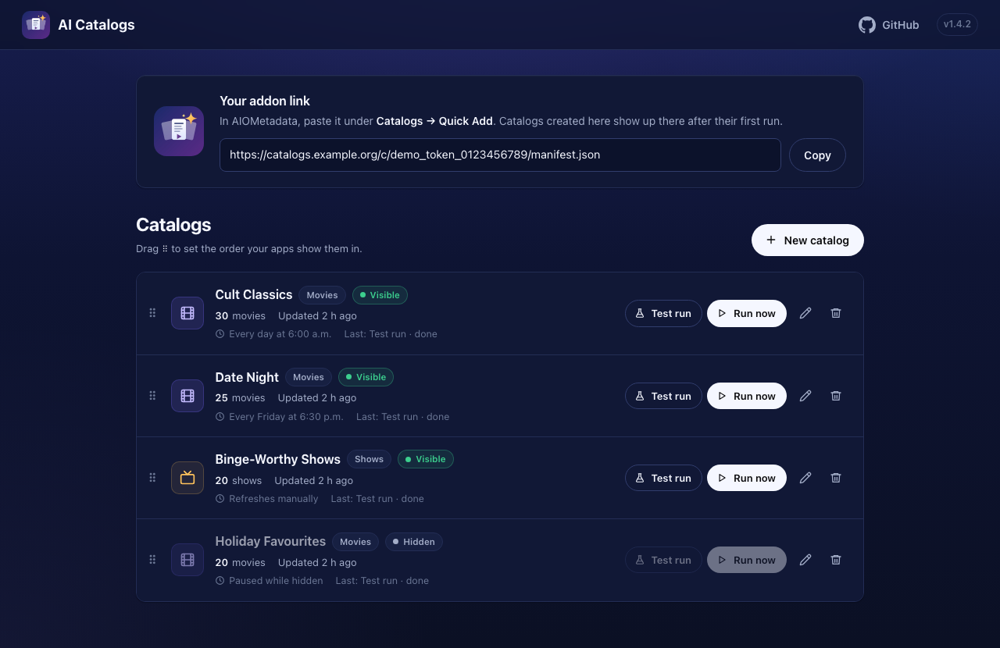

<p align="center">
  
</p>

<h1 align="center">AI Catalogs</h1>

<p align="center">
  Fresh, hand-picked movie catalogs for Stremio, chosen by AI and refreshed on your schedule.
</p>

---

Describe the kind of movies you want, and AI Catalogs builds the catalog for you. It asks an AI
model for ideas, checks every film against TMDB, drops anything that doesn't fit your rules,
and serves it to [AIOMetadata](https://github.com/cedya77/aiometadata), which shows it
in Stremio as a normal catalog. Each refresh brings new picks, and nothing you saw recently
comes back too soon.

## All your catalogs in one place

See every catalog at a glance, drag them into order, run one with a click, and copy the one link
you paste into AIOMetadata.



## Describe what you want

Describe the movies you want in plain words, pick how many and how often it runs. No special
syntax needed.


## Set your rules

Minimum rating, years, length, language and movies to never include, picked from suggestions as
you type. Movies that break a rule never make the catalog. Fine-tuning lives under Advanced.


## Try it before it goes live

A test run shows the movies the AI would pick, how many passed your rules and why the rest were
turned away, without changing what your apps show. Happy with it? Run it for real. Didn't like a
new version? Bring back an earlier one in two clicks.


## Good to know

- **Refreshes on its own.** Daily, weekly, or whenever you like.
- **No repeats.** Movies from recent versions are held back so every refresh feels new.
- **Skips what you've watched**, if you connect MDBList.
- **Stays within budget.** You set how many AI requests it may make each day.
- **Your catalogs stay private.** Your addon link has a secret part, set during setup, so only people you share it with can see them.

## Get started

AI Catalogs runs on your own server with Docker. You need an AI key, either
[OpenRouter](https://openrouter.ai) or a [Gemini](https://aistudio.google.com) key from Google,
and a free [TMDB](https://www.themoviedb.org) key.

## Self-hosting (Docker Compose)

```yaml
services:
  ai-catalogs:
    image: ghcr.io/renewedkeys/ai-catalogs:latest
    container_name: ai-catalogs
    restart: unless-stopped
    ports:
      - "8000:8000"  # Remove this if using Traefik
    # expose:  # Uncomment if using Traefik
    #   - 8000
    env_file:
      - .env
    environment:
      - PUID=${PUID:-1000}
      - PGID=${PGID:-1000}
      - TZ=${TZ:-Etc/UTC}
      # - PUBLIC_BASE_URL=https://${AI_CATALOGS_HOSTNAME?}  # Uncomment if using Traefik
    volumes:
      - ${DOCKER_DATA_DIR:-./data}/ai-catalogs:/data
    # labels:  # Optional: remove if not using Traefik
    #   - "traefik.enable=true"
    #   - "traefik.http.routers.ai-catalogs.rule=Host(`${AI_CATALOGS_HOSTNAME?}`)"
    #   - "traefik.http.routers.ai-catalogs.entrypoints=websecure"
    #   - "traefik.http.routers.ai-catalogs.tls.certresolver=letsencrypt"
    #   - "traefik.http.routers.ai-catalogs.middlewares=authelia@docker"
    #   - "traefik.http.services.ai-catalogs.loadbalancer.server.port=8000"
    # profiles:  # Optional: for compose setups that start apps by profile
    #   - ai-catalogs
    #   - all

  # Runs the catalogs on their schedules. Same image, no port.
  ai-catalogs_worker:
    image: ghcr.io/renewedkeys/ai-catalogs:latest
    container_name: ai-catalogs_worker
    restart: unless-stopped
    command: ["python", "-m", "app.worker"]
    stop_grace_period: 30s
    env_file:
      - .env
    environment:
      - PUID=${PUID:-1000}
      - PGID=${PGID:-1000}
      - TZ=${TZ:-Etc/UTC}
    volumes:
      - ${DOCKER_DATA_DIR:-./data}/ai-catalogs:/data
    healthcheck:
      test: ["CMD", "python", "-m", "app.curation", "status", "--check"]
      interval: 30s
      timeout: 10s
      start_period: 120s
      retries: 3
    # profiles:
    #   - ai-catalogs
    #   - all
```

Create a `.env` next to it from [.env.example](.env.example): an AI key (`OPENAI_API_KEY` for
OpenRouter, or `GEMINI_API_KEY` for Google's Gemini API), a free `TMDB_API_KEY`, an
`ADDON_ACCESS_TOKEN`, and `ENABLE_EDITOR=true` with either a password (`SESSION_SECRET`,
`ADMIN_PASSWORD`) or, behind Authelia, `EDITOR_AUTH=proxy`. Then:

```bash
docker compose up -d
```

Open `http://<your server>:8000` (or your hostname behind Traefik) to create your first catalog.
To update later:

```bash
docker compose pull && docker compose up -d
```

**Behind Traefik and Authelia** (for example the Viren070 docker-compose-template): uncomment
`expose`, `PUBLIC_BASE_URL`, the labels and the profiles, remove `ports`, set `EDITOR_AUTH=proxy`
in `.env`, and add `AI_CATALOGS_HOSTNAME=aicatalogs.${DOMAIN}` to the root `.env`. In Authelia,
add the hostname to the Stremio addon list (`TEMPLATE_STREMIO_ADDON_HOSTNAMES`) like your other
addons: that protects the configuration page and keeps the addon link reachable for AIOMetadata.
With Cloudflare DDNS, add the hostname to its `DOMAINS` too. The [setup guide](docs/setup.md) has
every setting.

## Licence

MIT. See [LICENSE](LICENSE).
